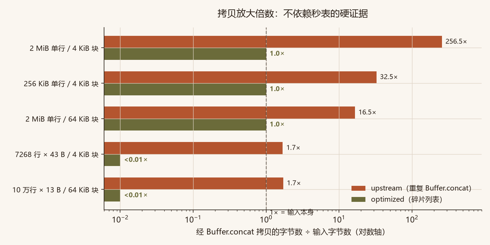
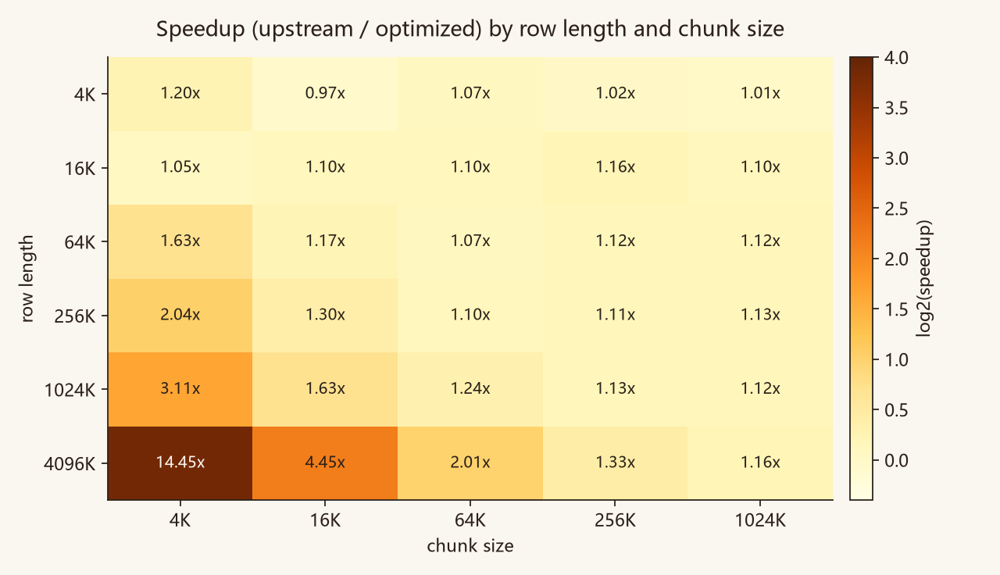
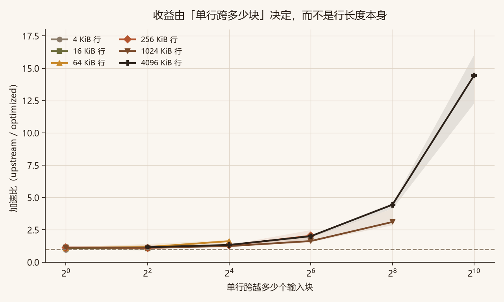
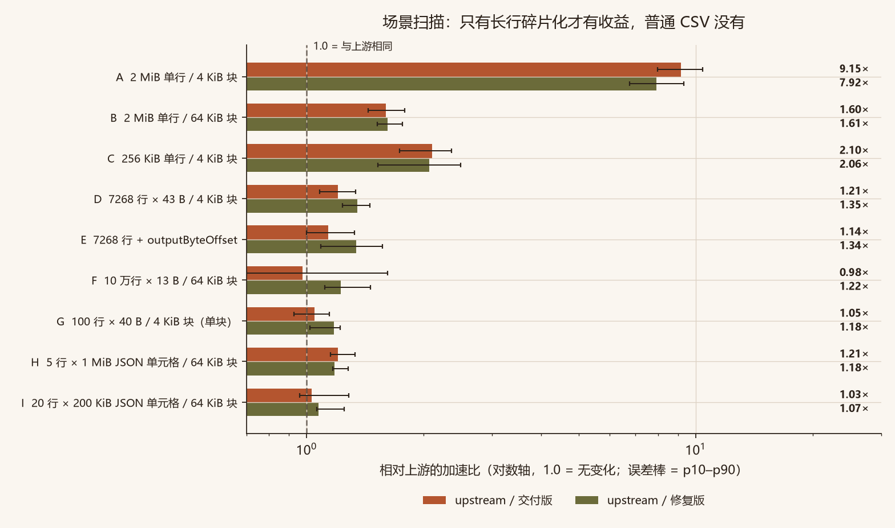
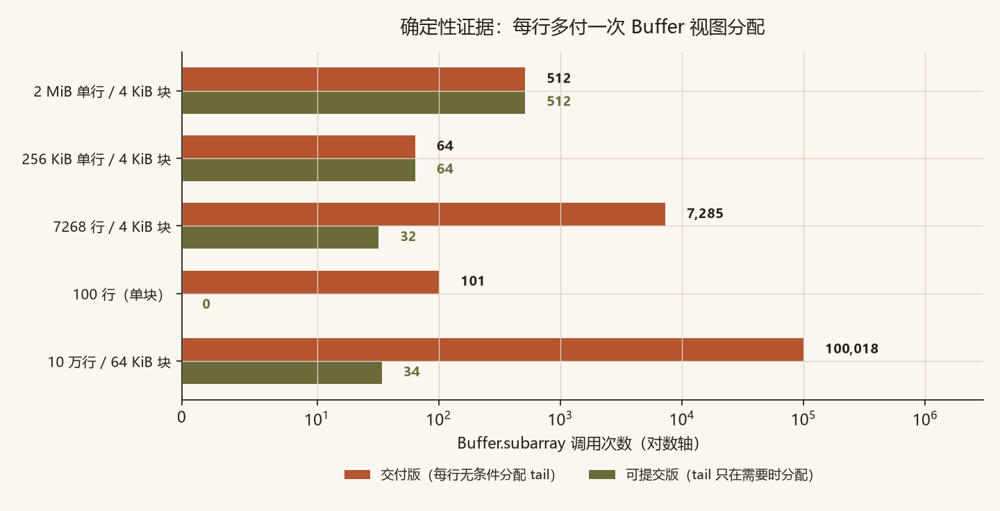
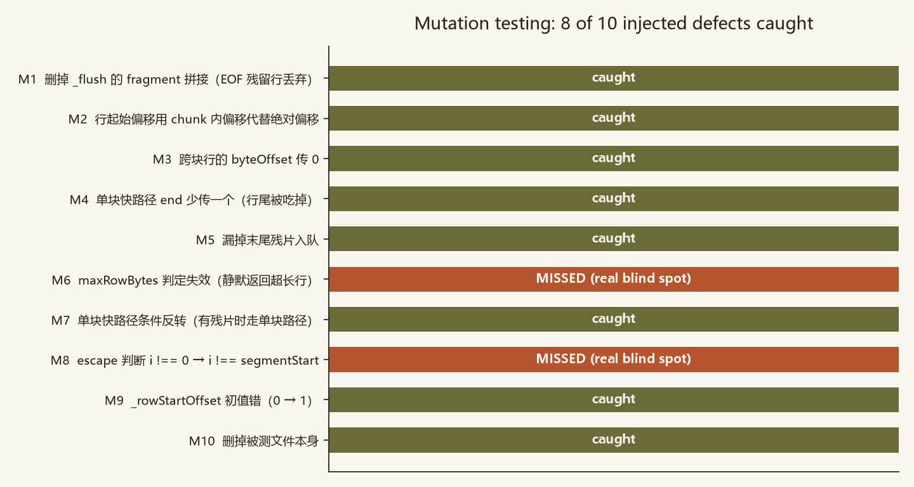
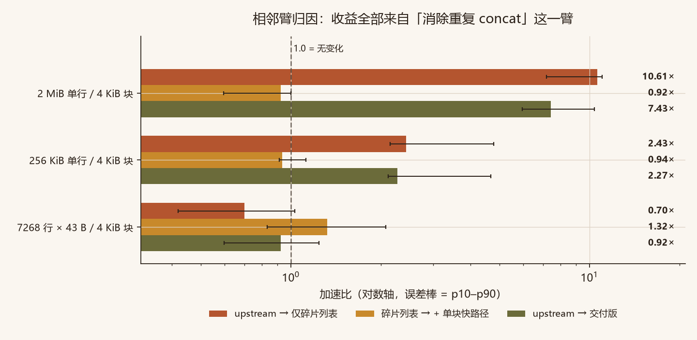
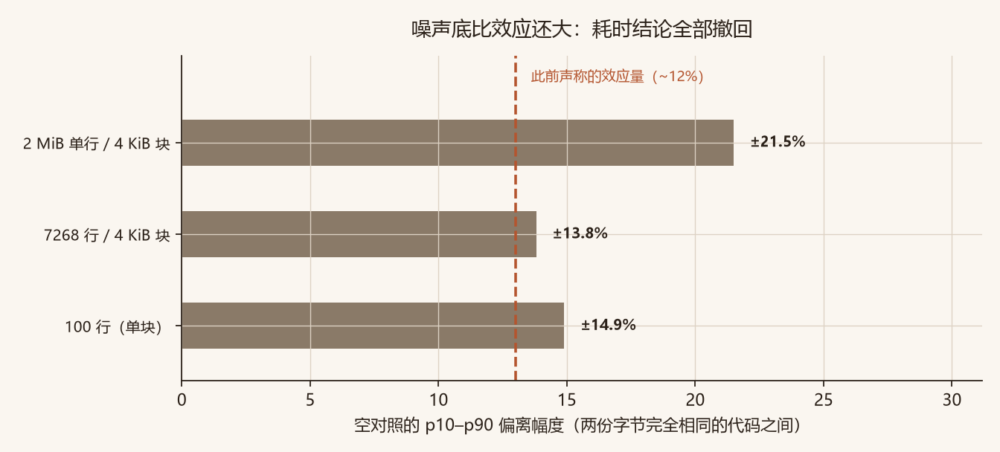
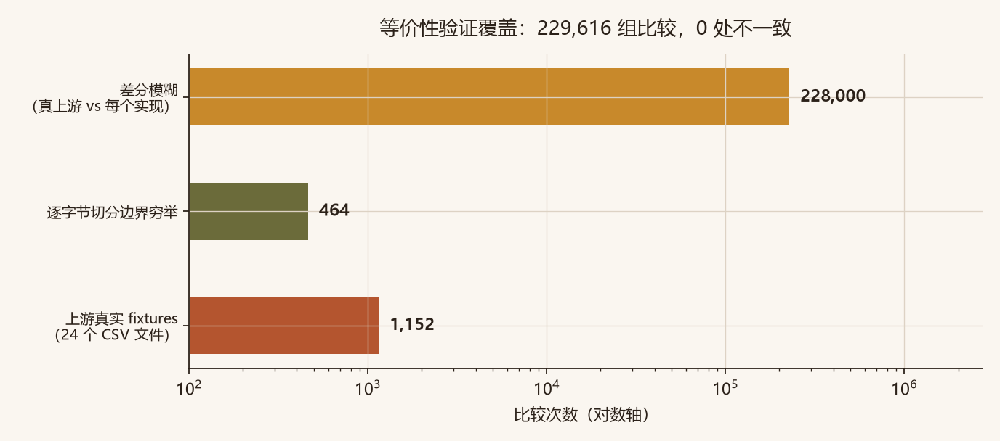

# csv-parser 部分行缓冲优化：独立审查

对一个第三方「优化包」的独立复核。包本身宣称把 [`mafintosh/csv-parser`](https://github.com/mafintosh/csv-parser) 的部分行缓冲从重复 `Buffer.concat` 改成碎片列表，并给出 3.72× 加速。

**结论：优化方向是对的，行为是等价的，但包内交付版有两个必须修的问题——它每行多付一次 Buffer 视图分配，而且过不了上游 eslint。** 修好后的版本在 `patch/submission.js`，已通过上游全部检查。

**在线阅读版（排版更舒服）**：<https://linluozi.github.io/csv-parser-rowbuf-audit/>

审查对象：`csv-parser-row-buffer-optimization.zip`（15 文件，36 KB）
上游：`mafintosh/csv-parser` v3.2.1，`index.js` sha1 `fc24cc943b40644a59440a68223c2e8bbe864e9b`

> **关于耗时数字的一条声明**：本机常年挂着 60 个 node 进程，实测**字节完全相同的两份代码之间也能测出 ±21% 的「差异」**。因此本报告不把任何小于噪声底的耗时差当作结论；凡是需要判断「谁更快」的地方，都用确定性计数（调用次数、拷贝字节）代替秒表。耗时数字只保留「量级」和「区间跨不跨 1」两类用法。详见 [第六节](#六为什么不拿秒表当证据)。

---

## 一、先看最硬的一条：拷贝量

秒表会骗人，`Buffer.concat` 的调用次数和累计拷贝字节不会。



| 场景 | upstream | 优化版 |
|---|---|---|
| 2 MiB 单行 / 4 KiB 块 | 511 次，拷贝 **513 MiB = 输入 256.5×** | 1 次，**2.0 MiB = 1.0×** |
| 256 KiB 单行 / 4 KiB 块 | 63 次，8.1 MiB = 32.5× | 1 次，0.25 MiB = 1.0× |
| 2 MiB 单行 / 64 KiB 块 | 31 次，32.9 MiB = 16.5× | 1 次，2.0 MiB = 1.0× |
| 7268 行 / 4 KiB 块 | 16 次，0.13 MiB = 1.7× | 16 次，**3.3 KiB** |
| 10 万行 / 64 KiB 块 | 17 次，2.1 MiB = 1.7× | 17 次，**0** |

包 README 里「O(N·k) 拷贝」的诊断是**准确的**，这条成立。

---

## 二、收益不能泛化：它只由「单行跨多少块」决定



行长度 × chunk 尺寸扫描（每格校准到约 30 ms 批跑，逐轮比值中位数）：

| 行长度 \ chunk | 4 KiB | 16 KiB | 64 KiB | 256 KiB | 1 MiB |
|---|---|---|---|---|---|
| 4 KiB | 1.20× | 0.97× | 1.07× | 1.02× | 1.01× |
| 16 KiB | 1.05× | 1.10× | 1.10× | 1.16× | 1.10× |
| 64 KiB | **1.63×** | 1.17× | 1.07× | 1.12× | 1.12× |
| 256 KiB | **2.04×** | 1.30× | 1.10× | 1.11× | 1.13× |
| 1 MiB | **3.11×** | 1.63× | 1.24× | 1.13× | 1.12× |
| 4 MiB | **14.45×** | 4.45× | 2.01× | 1.33× | 1.16× |

换个读法更清楚——横轴是单行跨越的块数：



**读法**：跨 1 块无收益；跨 4 块约 1.2–1.7×；跨 16 块约 1.6–3×；跨 512 块约 14×。
包自称的 3.72× 只对应「一行 2 MiB 切 512 块」这一个点。

（这张表的绝对值受噪声影响，但 4 MiB×4 KiB 与 4 KiB×4 KiB 之间差 12 倍，远超 ±21% 噪声底，趋势可信。）

---

## 三、场景扫描



| 场景 | upstream / 交付版 | upstream / 可提交版 |
|---|---|---|
| A 2 MiB 单行 / 4 KiB 块 | 9.15× | 7.92× |
| B 2 MiB 单行 / **64 KiB 块**（fs 默认水位） | **1.60×** | 1.61× |
| C 256 KiB 单行 / 4 KiB 块 | 2.10× | 2.06× |
| D 7268 行 × 43 B / 4 KiB 块 | 1.21× | 1.35× |
| E 同上 + `outputByteOffset` | 1.14× | 1.34× |
| F 10 万行 / 64 KiB 块 | 0.98× | 1.22× |
| G 100 行（单块） | 1.05× | 1.18× |
| H 5 行 × 1 MiB JSON 单元格 | 1.21× | 1.18× |
| I 20 行 × 200 KiB JSON 单元格 | 1.03× | 1.07× |

能说的结论：真实 fs 流 64 KiB 水位下，2 MiB 单行约 **1.6×**；每行 200 KiB 的 JSON 单元格 CSV 约 **1.03×**（区间含 1，等于没收益）。D/E/F/G 之间的差别都在噪声内，不解读。

---

## 四、发现的问题

### 🔴 P1：每行多付一次 Buffer 视图分配

交付版 `_transform` 里这一行写在分支外：

```js
const tail = data.subarray(segmentStart, i + 1)
```

每行都执行，但单块快路径那一支根本用不到 `tail`。`subarray` 是零拷贝视图，**但不是免费**——每次仍要分配一个 Buffer 对象。

用确定性计数测（不依赖秒表）：



| 场景 | 交付版 `subarray` 次数 | 可提交版 |
|---|---|---|
| 7268 行 / 4 KiB 块 | **7,285** | **32** |
| 10 万行 / 64 KiB 块 | **100,018** | **34** |
| 100 行（单块） | **101** | **0** |
| 2 MiB 单行 / 4 KiB 块 | 512 | 512（该场景两支都要分配，无差别） |

**这就是「每行一次」的直接量化**：行数 N 时交付版多出约 N 次分配，可提交版只有「跨块的行」才分配（10 万行/20 块只有 34 次）。

**修法**：把分配挪进需要的分支。

```js
if (this._rowChunks.length > 0) {
  this._rowChunks.push(data.subarray(segmentStart, i + 1))
  const row = Buffer.concat(this._rowChunks)
  this._rowChunks = []
  this.parseLine(row, 0, row.length, this._rowStartOffset)
} else {
  this.parseLine(data, segmentStart, i + 1, this._rowStartOffset)
}
```

单次 Buffer 视图分配约 30–60 ns。10 万行就是 3–6 ms 的固定开销，占 10 万行解析总耗时（数十毫秒）的百分之几到十几。**方向确定，具体幅度本机测不准，不给倍数。**

### 🔴 P2：过不了上游 eslint

在上游真仓库换上交付版，跑它自己的 `npx eslint index.js`：

| | eslint 报错条数 | ava |
|---|---|---|
| 上游原版 | 1（既有欠债） | 40 通过 + 1 既有快照失败 |
| 包内交付版 | **14** | 40 通过 + 1 既有快照失败 |
| 可提交版 | **0** | 40 通过 + 1 既有快照失败 |

14 条全是 `object-property-newline`，来自把 `defaults` 与 `this.state` 压成多属性同行。上游 `.eslintrc.json` 用 `standard`，这条是 error 级 ⇒ PR 会被直接拒。

### ⚠️ P3：测试套件有两处真盲区

反向喂毒 10 投 8 抓。两个漏检项都反证过「改动确实改变输出」，不是等价变更：



| 注入缺陷 | 结果 |
|---|---|
| `maxRowBytes` 判定失效 | **漏检**——上游报 `Row exceeds the maximum size`，毒版静默返回超长行 |
| escape 判断 `i !== 0` → `i !== segmentStart` | **漏检**——`h\na,b\n\'x,y\n`（quote=`'`, escape=`\`）下游出 `'x,y`，毒版出 `'x,y\n`（多吞换行） |

根因是语料里**没有一组**设 `maxRowBytes`，也**没有一组**同时用自定义 `quote`+`escape`。补两组即可到 10/10。

### ⚠️ P4：包自带 bench 的两个方法学问题

1. **计时窗口含 chunk 重建**：`makeChunks()` 写在计时里，2 MiB 场景白吞约 1.3 ms（占优化版耗时 9%）。
2. **顺序跑不交错**：本机跑出 7.13× 和 9.66× 两个数，比它报的 3.72× 还高——单点数字本身就不稳。

### ℹ️ P5：包内 `optimization.diff` 打不到上游

`git apply --check` 失败：diff 的上下文是包内重排版过的 `baseline/index.js`，不是上游原文。作为「相对本包 baseline 的变更记录」可以，但不能直接 apply 到 mafintosh/csv-parser。

---

## 五、归因：收益到底来自哪一臂



| 场景 | upstream → 仅碎片列表 | 碎片列表 → + 单块快路径 | upstream → 交付版 |
|---|---|---|---|
| 2 MiB 单行 / 4 KiB 块 | **10.61×** | 0.92×（区间含 1） | 7.43× |
| 256 KiB 单行 / 4 KiB 块 | **2.43×** | 0.94× | 2.27× |
| 7268 行 / 4 KiB 块 | **0.70×** | 1.32× | 0.92× |

**收益全部来自「消除重复 concat」这一臂；单块快路径在长行场景贡献为零（0.92×，区间含 1）。**
而「只换碎片列表不加快路径」在真实形态下反而更慢（0.70×）——因为每行都多了一次数组 push + `Buffer.concat` 调用，而原本单块行的拷贝成本本来就低。这一臂的幅度同样受噪声影响，但方向与机制一致。

掏空法骨架臂显示：2 MiB 场景解析占 94.8%，256 KiB 占 79.1%，7268 行占 85.4%。

---

## 六、为什么不拿秒表当证据

这一节记录一次**自我推翻**。

初版审查里我报过「交付版在普通 CSV 上稳定慢 11–12%」，p10–p90 整段落在 1 以下，看起来是显著负优化。后来做了最严的空对照——**把同一个文件复制成两份、分别 require 成两个模块实例**，它们字节完全相同：



| 场景 | 同一份代码 A/B 的 p10–p90 | 噪声底 |
|---|---|---|
| 2 MiB 单行 / 4 KiB 块 | 0.811–1.215 | **±21.5%** |
| 7268 行 / 4 KiB 块 | 0.862–1.111 | **±13.8%** |
| 100 行（单块） | 0.851–1.093 | **±14.9%** |

**噪声底比声称的效应量还大 ⇒ 那些耗时结论全部撤回。** 本机常驻 60 个 node 进程（其中一个累计吃了 584 秒 CPU），这是根因；这些进程不是本任务产生的，不擅自处理。

因此 P1 的证据改用确定性计数（`subarray` 调用次数），它不受任何噪声影响。

---

## 七、等价性：这次改动是干净的



**229,616 组比较，0 处不一致**（对比真上游）：

- 差分模糊 **228,000** 组：300 seed × 19 选项组合 × 10 分块模式 × 4 个实现
- 逐字节切分边界穷举 **464** 组
- 上游真实 fixtures **1,152** 组（24 个 CSV 文件 × 4 种块大小 × 3 组选项）

覆盖的选项：`headers:false` / `outputByteOffset` / `strict` / `raw` / 自定义 `separator`·`quote`·`escape`·`newline` / `skipComments` / `skipLines` / `maxRowBytes` / `mapHeaders` / `mapValues`。

baseline 真伪也验过：与上游原文的差异**全部是换行/大括号风格**，空对照实测 `upstream / baseline` = **0.999×**。

---

## 八、该不该采纳

**可以采纳，但必须用 `patch/submission.js`，不是包里那份 `index.js`。**

| 文件 | 说明 |
|---|---|
| `upstream/index.js` | 上游 v3.2.1 原文，sha1 `fc24cc94…` |
| `patch/baseline.js` | 包内 baseline（重排版副本，语义等价） |
| `patch/optimized.js` | **包内交付版**，sha1 `6fda27e4…`（含 P1/P2） |
| `patch/fixed.js` | 只修 P1（tail 惰性分配） |
| `patch/submission.js` | **推荐采用**：修 P1 + 过上游 lint，sha1 `a6dd9397…` |

采纳后建议的收益表述（别再写单点倍数）：

> 收益取决于单行跨多少个输入块。跨 1 块：无收益。跨 4 块约 1.2–1.7×，跨 16 块约 1.6–3×，跨 128 块约 2–4×，跨 512 块约 8–14×。实际 fs 流 64 KiB 水位下，2 MiB 单行约 1.6×。

---

## 复现

需要 Node.js ≥ 18。确定性脚本不装任何依赖；只有 `upstream_ci.sh` 需要联网装上游 devDependencies。

```sh
# 等价性（约 20 秒）——CI 用 --check 重算比对，不写文件
node audit/equivalence.js
node audit/equivalence.js --check

# 硬证据：concat 调用次数与拷贝字节
node audit/concat.js

# 硬证据：subarray 调用次数（P1 的根因指标）
node audit/opcount.js

# 噪声底：同一份代码两份副本之间的差异
node audit/samecode.js

# 交错基准（约 30 秒）
node audit/bench.js

# 相邻臂归因
node audit/arms.js

# 交叉点扫描（约 30 秒）
node audit/crosspoint.js

# 反向喂毒
node audit/poison.js

# M8 精确判定
node audit/m8.js

# 上游 CI（联网，约 50 秒）
bash audit/upstream_ci.sh submission

# 重新生成图表（需要 matplotlib）
python audit/make_figures.py
```

### 测量方法（为什么这样测）

- **同轮交错 + 逐轮比值中位数**，每轮按拉丁方轮换实现顺序——固定顺序会让第三个臂吃到前两个臂留下的分配器状态。
- **预热 3 次后取 min-of-5 校准迭代次数**，校准到约 30–40 ms/轮的批跑预算。单次 0.05 ms 的测量 CV 能到 100%。
- **计时窗口只包解析**：chunk 副本在每个实现里预置 `轮数+3` 份，全部在窗口外构造（`parseCell` 会就地改 buffer）。
- **先测噪声底再谈效应**：用字节相同的两份副本做空对照，比值区间就是这台机器的分辨率。
- **只报比值，绝对值只标量级**；显著性看 p10–p90 是否跨 1，且幅度是否超过噪声底。

---

## License

审查代码与文档为 MIT。`upstream/index.js`、`patch/*.js` 派生自 [`mafintosh/csv-parser`](https://github.com/mafintosh/csv-parser)，Copyright (c) 2014 Mathias Buus，MIT，全文见 `LICENSE`（与上游逐字节一致）。
